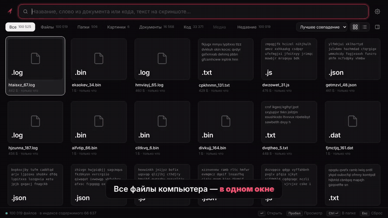
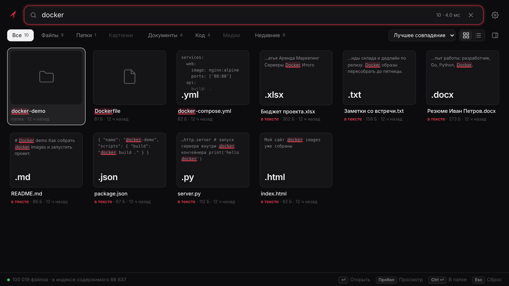
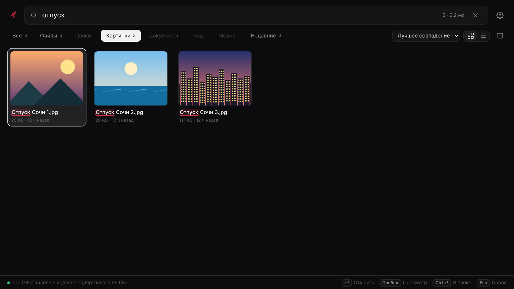
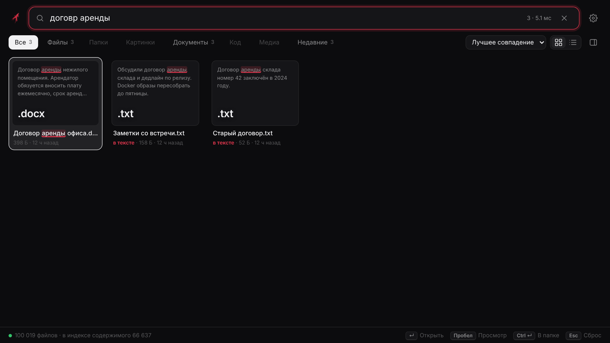
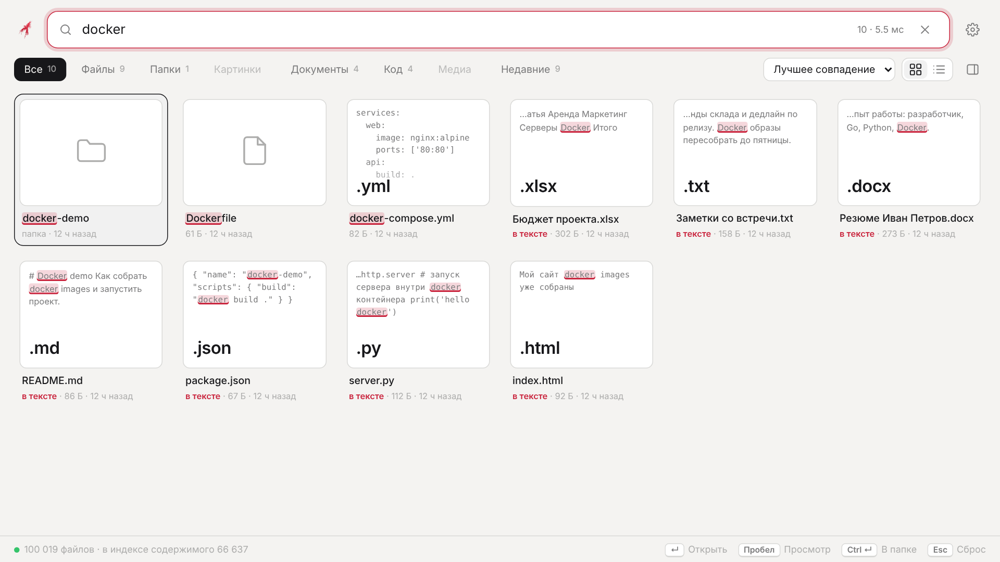
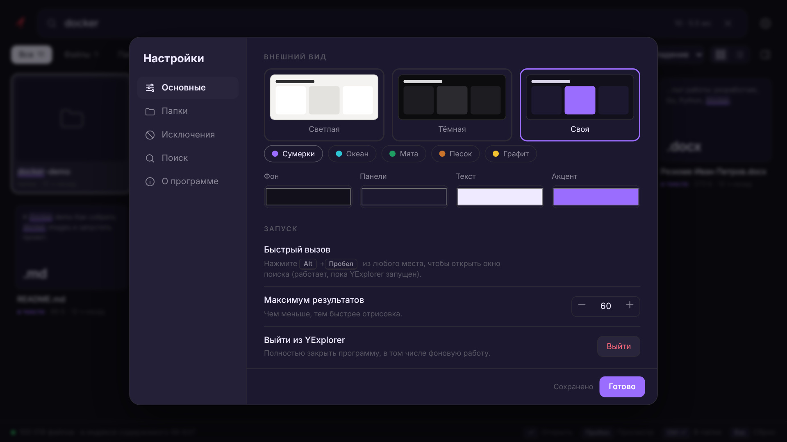

<div align="center">


# YExplorer

**Мгновенный поиск файлов для Windows — замена Проводнику с мощным поиском.**
*Instant file search for Windows: names, document & code contents, screenshots, typo-tolerant.*




[🎬 Видео-ролик](docs/YExplorer-promo.mp4) · [⬇️ Скачать exe](../../releases/latest)

</div>

---

## ✨ Возможности

- 🔎 **Ищет не только по названиям**, но и **по содержимому**: txt, md, json, исходный код, docx, xlsx, pptx, odt, pdf, html и др.
- 🖼️ **Текст на скриншотах** (OCR встроенным движком Windows 10/11).
- 🧠 **Понимает опечатки**: «договр аренды» → *Договор аренды*; исправляет **неверную раскладку** («lbpfqy» → «дизайн»).
- ⚡ **Быстро**: индекс в памяти, поиск по 100 000 файлов занимает единицы–десятки миллисекунд (время показано в строке поиска).
- 🎨 **Темы**: тёмная, светлая и **своя** (4 цвета + пресеты).
- 👀 Сетка с миниатюрами и сниппетами, список, панель предпросмотра (`Пробел`), фильтры: Файлы, Папки, Картинки, Документы, Код, Медиа, Недавние.
- ⌨️ Клавиатура: `↵` открыть · `Ctrl+↵` показать в папке · `Пробел` просмотр · `Ctrl+K` фокус на поиск · `Alt+Пробел` — вызов окна.
- 🔒 Всё локально: индекс на вашем диске, интернет не используется.
- 📦 Один exe (~8 МБ), без установки и без внешних зависимостей.

## 📸 Скриншоты

| Поиск по содержимому | Картинки |
|---|---|
|  |  |
| **Опечатки** | **Светлая тема** |
|  |  |



## 🚀 Установка

Скачайте `YExplorer.exe` из [Releases](../../releases/latest) и запустите. Windows SmartScreen может предупредить о неподписанном приложении — это нормально для проектов с открытым кодом.

Требуется Windows 10/11 и Microsoft Edge или Chrome (окно открывается в режиме приложения).

## 🛠️ Сборка из исходников

```bash
GOOS=windows GOARCH=amd64 CGO_ENABLED=0 go build -trimpath -ldflags="-s -w -H=windowsgui" -o YExplorer.exe .
```

Запуск для разработки на Linux/macOS: `YX_NOLAUNCH=1 go run .` (адрес окна выводится в консоль). Переменные: `YX_ROOTS` (папки), `YX_DATA` (где хранить индекс).
Иконка exe: `python3 assets/mksyso.py assets/icon512.png rsrc_windows_amd64.syso`.

## 🧩 Устройство

| Файл | Назначение |
|---|---|
| `index.go` | снимок файлов, поиск, опечатки (триграммы + Дамерау–Левенштейн) |
| `indexer.go` | сканирование, чтение содержимого, OCR |
| `extract.go` | текст из txt/код/docx/xlsx/pptx/odf/pdf |
| `server.go`, `main.go` | локальный HTTP API (защищён токеном), жизненный цикл |
| `platform_windows.go` | открытие файлов, диски, автозапуск, Alt+Пробел, OCR |
| `web/index.html` | весь интерфейс |

## ⚠️ Статус

Проект молодой. Ядро поиска и интерфейс проверены на тестовых данных; интеграция с Windows (OCR, автозапуск, горячая клавиша, выбор папки) написана, но ещё нуждается в проверке на реальных машинах. PDF разбирается упрощённо и может не прочитать часть файлов. Issues и PR приветствуются.

## 📄 Лицензия

MIT
